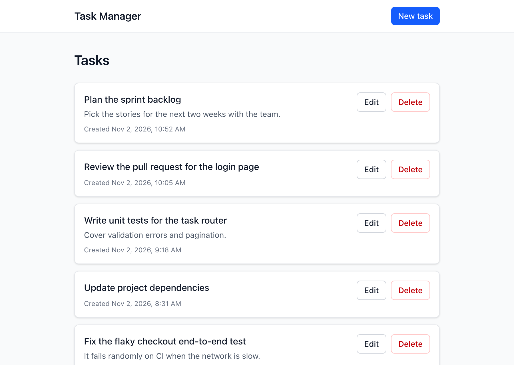
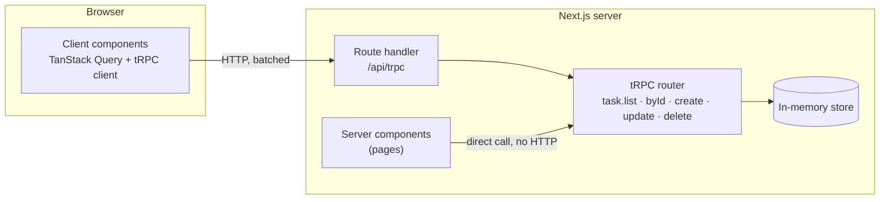

# Task Manager — Next.js 15 + tRPC

A simple task manager. The backend keeps the tasks in memory and exposes them through tRPC; the frontend lists, creates, edits and deletes them.



## Features

- **CRUD over tRPC**: create, list, update and delete tasks (`id`, `titulo`, `descricao`, `dataCriacao`), stored in memory on the server.
- **Same validation on both sides**: one Zod schema validates the form in the browser and the procedure input on the server, so a task can't be created without a title.
- **Meaningful errors**: `NOT_FOUND` when updating or deleting a task that doesn't exist, and `BAD_REQUEST` with a message per field for invalid input.
- **Server-rendered list**: the first page of tasks is fetched on the server and comes in the HTML.
- **Delete from the list**, with a pending state and success or error notifications.
- **Create and edit form** built with function components and hooks, with loading, success and error states.
- **Bonus**: infinite scroll on the list, comments on the main decisions, this README, and unit tests for the router.

## Tech stack

| | |
|---|---|
| Framework | Next.js 15 (App Router), React 19 |
| API | tRPC 11, TanStack Query 5 |
| Validation | Zod 4 |
| Styling | Tailwind CSS 4 |
| Tests | Vitest |

The challenge asks for Next.js 15, so the project uses its latest 15.x release. All the other libraries are on their latest versions.

## Getting started

You need Node.js 22.12 or newer.

```bash
npm install
npm run dev
```

Then open http://localhost:3000. The app starts with some fictional sample tasks. Since everything is in memory, restarting the server resets the list.

| Script | What it does |
|---|---|
| `npm run dev` | Starts the development server |
| `npm run build`, then `npm start` | Builds and runs the production server |
| `npm test` | Runs the tRPC router tests |
| `npm run lint` | Runs ESLint |

## How it works



### Rendering

| Route | Strategy | Why |
|---|---|---|
| `/` (task list) | SSR on every request, then CSR for the next pages | The first HTML always has the current tasks. Further pages load in the browser while scrolling. |
| `/tasks/new` | Static (SSG) | Nothing on it depends on data. |
| `/tasks/[id]/edit` | SSR | The form arrives already filled in, and an unknown id gets a 404. |

On the list page, the server component prefetches the first page through tRPC, calling the router directly, and passes it to the browser with TanStack Query's hydration, so the browser doesn't request it again. Mutations go through the HTTP endpoint and then invalidate the `task` queries, which refreshes the list.

### Validation and errors

- `src/lib/task-schema.ts` is used by the form and by the procedures, so both apply the same rules and messages.
- The tRPC error formatter adds Zod's field errors to the response, so if the server rejects a field, the form shows the message next to it.
- An unknown id returns `NOT_FOUND` ("Task not found"). The list shows it as a notification when deleting; the form shows it above its buttons when saving.
- An unexpected error on a page falls back to `error.tsx`, which has a retry button.

### Pagination

`task.list` uses keyset pagination: the cursor is the last task the client already has (`dataCriacao` and `id`), not an offset. Because of that, deleting tasks while scrolling doesn't make the next page skip any.

### In-memory store

The store is a `Map` kept on `globalThis`. Next.js can load the same module more than once in one process (separate bundles, hot reloads), and all of them must see the same data. The store is created by a factory and reaches the procedures through the tRPC context, so each test gets a fresh one.

## Project structure

```
src/
├── app/
│   ├── api/trpc/[trpc]/route.ts   # tRPC HTTP endpoint
│   ├── page.tsx                   # task list (SSR)
│   ├── tasks/new/page.tsx         # create form (static)
│   ├── tasks/[id]/edit/page.tsx   # edit form (SSR)
│   └── layout.tsx, error.tsx, not-found.tsx
├── components/
│   ├── task-list.tsx              # list, infinite scroll, delete
│   ├── task-form.tsx              # create and edit form
│   └── toast.tsx                  # notifications
├── lib/
│   ├── task.ts                    # Task type and constants
│   └── task-schema.ts             # Zod schema shared by the client and the server
├── server/
│   └── task-store.ts              # in-memory repository
└── trpc/
    ├── init.ts                    # context, error formatter, procedure helpers
    ├── routers/                   # app router, task router and its tests
    ├── client.tsx                 # provider and hooks for client components
    ├── server.tsx                 # helpers for server components
    └── query-client.ts
```

## API

| Procedure | Type | Input | Output |
|---|---|---|---|
| `task.list` | query | `{ limit?, cursor? }` | `{ items: Task[], nextCursor }` |
| `task.byId` | query | `{ id }` | `Task` |
| `task.create` | mutation | `{ titulo, descricao? }` | `Task` |
| `task.update` | mutation | `{ id, titulo, descricao? }` | `Task` |
| `task.delete` | mutation | `{ id }` | `{ id }` |

```ts
type Task = {
  id: string;          // UUID generated by the server
  titulo: string;      // required, up to 100 characters
  descricao?: string;  // optional, up to 500 characters
  dataCriacao: number; // Unix timestamp in milliseconds
};
```

The field names are in Portuguese because the challenge specifies them that way.

## Limitations and next steps

- The data is lost when the server restarts, and isn't shared between instances (for example, serverless functions). A database (for example, PostgreSQL with Prisma or Drizzle) could replace the store without changing the router.
- There's no authentication, so every procedure is public. With users, a `protectedProcedure` middleware would check the session and scope the tasks to each user.
- Possible improvements: optimistic updates, a confirmation before deleting, and end-to-end tests with Playwright.
